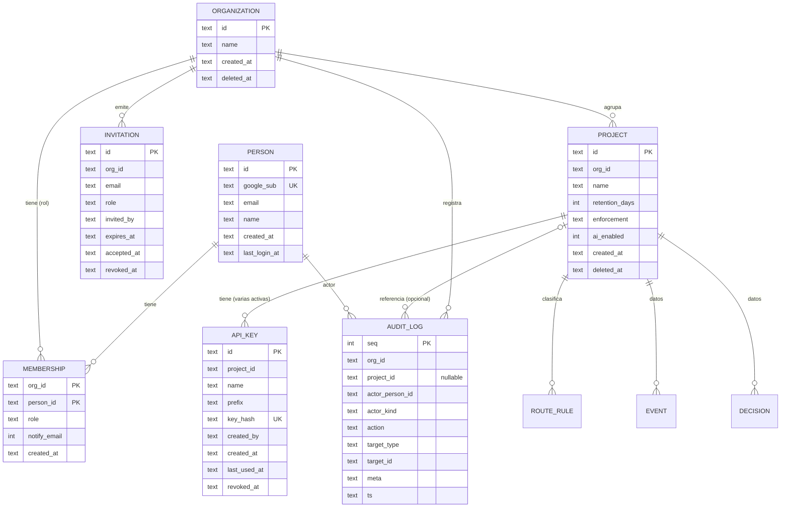

# Diseño de producto: proyectos, personas y operación

**Estado:** propuesta para decidir (2026-10-25). Nada de esto está construido. Al aceptarse, los contratos nuevos se pasan a [REPARTO.md](REPARTO.md) en el mismo commit que el código, como pide ese documento.

> **Revisión 2026-10-25: capa de organización.** Decisiones del usuario: (1) hay una organización por encima de los proyectos; (2) los roles viven **solo** en la organización (un rol por persona y organización, válido para todos sus proyectos; una lista de miembros por organización; sin roles por proyecto; una persona puede pertenecer a varias organizaciones). Qué cambia respecto a la versión anterior:
>
> - **Modelo:** nueva `Organization`; `Membership` e `Invitation` pasan de proyecto a organización; `Project` gana `org_id`; `ApiKey` sigue por proyecto; `AuditLog` gana `org_id` y `project_id` pasa a ser opcional.
> - **Roles:** se resuelven por organización, con tres reglas (siempre un owner por organización, nadie cambia su propio rol, un admin no gestiona owners).
> - **Panel y motor:** `X-Veridian-Project` sigue eligiendo el proyecto para leer datos; el motor autoriza con el rol del actor en la organización de ese proyecto. La administración de miembros, invitaciones y auditoría usa el id de la organización en la ruta.
> - **Contratos:** 10 (organizaciones y proyectos), 11 (miembros e invitaciones bajo `/v1/orgs/{id}/…`), 12 (solo cambia quién autoriza), 15 (auditoría por organización con `?project=`). `GET /v1/me/projects` y `POST /v1/projects` se sustituyen por `GET /v1/me/orgs` y `POST /v1/orgs/{id}/projects`.
> - **Corrección de una brecha previa:** el panel lee `GET /v1/blocklist` y `GET /v1/routes` (texto de la consecuencia de un bloqueo y página Rutas); ahora la tabla de llamantes los marca como accesibles para `sdk` **y** `panel`.
> - **Decisiones abiertas:** la 1 queda decidida; la 2 pasa a ser quién crea organizaciones. Valores provisionales (no preguntados): ver decisión 2.
> - **Plan de trabajo:** cambian U4, U6, U10 y U11.
> - **Eliminar una organización (decisión del usuario, 2026-10-25):** solo un `owner` puede hacerlo y solo cuando ya no le quedan proyectos (se eliminan antes, uno por uno); si tiene proyectos se rechaza. Se añade `DELETE /v1/orgs/{id}` al contrato 10 y se resuelve el hueco "eliminación de organización sin definir".

## Problema y objetivo

Veridian hoy funciona como demo de un solo cliente: los tokens son una variable de entorno, el panel no tiene login y lee el motor con un solo token, el endpoint de reinicio está encendido en producción y los datos personales (IP, user agent, `device_id`, `user_id`) se guardan sin límite de tiempo ni forma de borrarlos. Un cliente real no puede confiar en eso.

El objetivo es que una **persona** entre al panel con su cuenta de Google, vea **sus organizaciones y los proyectos de cada una** (puede pertenecer a varias organizaciones), cree y rote las claves de cada proyecto sin redeploy, invite a su equipo, se entere cuando se bloquea a alguien, y pueda borrar sus datos. Todo sirve al mismo problema: credenciales robadas usadas por otra persona. Quedan fuera facturación, SSO empresarial, otras fuentes de logs y cualquier detección que no sea de ese problema.

### Brechas que este documento cierra

| # | Brecha | Sección |
|---|---|---|
| 1 | Tokens estáticos en variable de entorno | Claves de API |
| 2 | Comparación no constante y sin límite de intentos fallidos | Seguridad |
| 3 | Panel sin login y de un solo cliente | Panel y motor |
| 4 | `VERIDIAN_ALLOW_RESET=true` en producción | Seguridad |
| 5 | Aislamiento entre clientes incompleto | Aislamiento |
| 6 | Sin aviso cuando se bloquea | Notificaciones |
| 7 | Datos personales sin retención ni borrado | Retención y borrado |
| 8 | Sin evaluación defendible de la detección | Evaluación |

## Modelo de dominio



`EVENT` y `DECISION` son las tablas actuales con `client_id` renombrado a `project_id`.

- **Person:** una persona con correo verificado, entre por Google o por GitHub. Cada proveedor aporta su id (`google_sub`: el `sub` de Google o `github:<id>`), estable; el mismo correo verificado por dos proveedores es la misma persona. El `email` puede cambiar. Una persona existe una vez, sin importar a cuántas organizaciones pertenezca.
- **Organization:** la empresa o cuenta que agrupa proyectos y personas. Es el nivel donde viven los miembros y los roles. Una persona puede pertenecer a varias. Se elimina con borrado lógico (`deleted_at`), solo por un `owner` y solo cuando no le quedan proyectos sin eliminar (contrato 10).
- **Project:** la unidad de datos y de claves. Reemplaza a `client_id` y pertenece a **una** organización (`org_id`). Todo dato de la plataforma de datos cuelga de un proyecto. No tiene miembros ni roles propios: hereda los de su organización.
- **Membership:** la relación persona–organización con un rol. Es la única fuente de permisos y vale para todos los proyectos de la organización. Una persona tiene un solo rol por organización.
- **Invitation:** invitación **a la organización** por correo con rol y vencimiento. Se acepta sola cuando esa persona entra con Google y el correo verificado coincide; no hace falta enviar correo para que funcione (ver decisión 4).
- **ApiKey:** secreto que usa el middleware. Se guarda solo el hash; `prefix` sirve para que la persona reconozca cuál es cuál. Un proyecto puede tener varias activas a la vez: así se rota sin cortar el servicio (crear la nueva, desplegarla, revocar la vieja).
- **AuditLog:** registro de solo agregar de quién hizo qué, por organización (`org_id`) y con una referencia opcional al proyecto (`project_id`, nulo en acciones de la organización como miembros o invitaciones). Cubre marcar una decisión como normal, operaciones sobre claves, miembros, invitaciones, ajustes del proyecto, borrados y cambios de rutas.
- **RouteRule:** la clasificación de rutas, ahora por proyecto (ver Aislamiento).

### Roles: owner, admin, viewer (a nivel de organización)

Los roles viven **solo** en la organización: una persona tiene un rol por organización y vale para todos los proyectos de esa organización. No hay roles por proyecto ni una segunda lista de miembros. Quien quiera dar acceso a un solo proyecto no puede: tendría que ser una organización aparte.

| Rol | Puede (en la organización y en todos sus proyectos) |
|---|---|
| `viewer` | Ver portada, actividad, decisiones, usuarios, perfiles y rutas de cualquier proyecto de la organización. Nada que cambie estado. |
| `admin` | Todo lo del viewer, más: crear proyectos, marcar decisiones como normales, administrar claves, rutas, webhook y ajustes de proyectos, invitar y quitar `viewer` y `admin`, cambiar rol entre `viewer` y `admin`, ver la auditoría, borrar datos de un usuario. |
| `owner` | Todo lo del admin, más: administrar otros `owner` (invitar, cambiar rol, quitar), borrar todos los datos de un proyecto, eliminar un proyecto, eliminar la organización (solo si no le queda ningún proyecto sin eliminar; antes hay que eliminar los proyectos uno por uno). |

**Reglas de dominio (se prueban):**

1. **Siempre hay al menos un owner por organización:** no se puede quitar ni degradar al último.
2. **Nadie cambia su propio rol ni se quita a sí mismo** (como `self` en Centinela).
3. **Un admin no gestiona owners:** no puede invitar con rol `owner`, ni cambiar o quitar a un owner, ni subir a nadie a `owner`.

**Por qué tres y no más:** `viewer` existe porque quien audita o apoya no debe poder levantar un bloqueo ni crear una clave. `owner` se separa de `admin` porque hay acciones irreversibles (eliminar el proyecto, borrar todos los datos) y porque necesitamos una regla simple contra quedarse sin responsable (la regla 1; igual que "último admin" en Centinela, `adapters/members.py`). **Por qué no menos:** con solo admin/viewer, cualquier admin podría borrar un proyecto o expulsar al dueño. **Por qué no permisos por ruta, por acción o por proyecto:** no sirve al problema y multiplica las pruebas (decisión del usuario, 2026-10-25).

## Dónde vive cada dato

| Plano | Datos | Quién los lee en caliente |
|---|---|---|
| **Control** | Person, Organization, Project, Membership, Invitation, ApiKey, AuditLog, RouteRule, ajustes del proyecto | El motor, en **cada** petición (la clave resuelve el proyecto) |
| **Datos** | events, decisions, decision_events, rate_spike_judgments, ai_judgments, blocklist_versions (los perfiles se calculan al leer, de `events`) | El motor |

### Opciones evaluadas

| Opción | A favor | En contra |
|---|---|---|
| **A. Control en la base del motor** (mismas migraciones, mismo proceso) | Una sola fuente de verdad; resolver la clave es una consulta local por índice; cambios de clave o revocación valen al instante; la auditoría puede ir en la **misma transacción** que el cambio; un solo despliegue | El motor guarda cuentas de personas (más superficie que proteger); el panel depende del motor para todo |
| B. Control en el panel (su propia base) | Separa responsabilidades | El motor debe validar claves en cada evento: o llama al panel (una dependencia síncrona en la ruta caliente, y `POST /v1/check` ya tiene un presupuesto de latencia) o replica las claves (dos copias que se desincronizan al revocar). El panel hoy no tiene disco ni base |
| C. Control y datos en un Postgres compartido | Mismo motor que se necesitará para escalar | Añade un servicio y un cambio de driver antes de tener un solo cliente real |

**Recomendación: A.** El motor ya es quien debe responder rápido con la clave; ponerle el control al lado elimina un salto de red y una clase de inconsistencias (clave revocada pero aún aceptada). El panel queda sin base propia: guarda solo una cookie de sesión firmada.

### SQLite ahora o Postgres ahora

**Recomendación: SQLite ahora, con reglas de portabilidad y disparadores explícitos para pasar a Postgres.**

- **A favor de quedarse:** el motor es un proceso con un disco de Render (`render.yaml`) y serializa escrituras con un candado en proceso; el control plane añade pocas escrituras (altas de claves y miembros) y una lectura por petición. Migrar a Postgres ahora retrasaría todo el resto sin resolver ninguna de las 8 brechas. `INIT.md` ya fija "SQLite para empezar, Postgres cuando se despliegue".
- **En contra, honestamente:** un disco adjunto impide tener más de una instancia y significa un corte corto en cada despliegue; la copia de seguridad hoy es la del disco de la plataforma (verificar qué ofrece Render antes de prometerla a un cliente: no verificado). Esos son los límites reales de A+SQLite.
- **Reglas de portabilidad (para que el día del cambio sea mecánico):** SQL estándar (sin `INSERT OR REPLACE`; usar `ON CONFLICT`, que ya se usa en `bump_version`), fechas en texto ISO UTC como hoy, ids de texto generados en la aplicación (no `AUTOINCREMENT` en tablas nuevas), acceso a datos solo desde los módulos del motor (no SQL en la capa HTTP), migraciones numeradas.
- **Disparadores para pasar a Postgres** (cualquiera): hace falta una segunda instancia o despliegue sin corte; el candado de escritura aparece como cuello de botella **medido** (hoy no hay medición); un cliente exige copias y restauración con garantías que el disco no da. No fijamos un número de clientes porque no tenemos ninguno medido.

### Migraciones (versionado del esquema)

Hoy `db.init_db` ejecuta `CREATE TABLE IF NOT EXISTS`, que no sabe cambiar tablas. Añadir `project_id` y quitar el `UNIQUE` global de `decisions.id` lo exige.

- Carpeta `engine/veridian_engine/migrations/` con archivos `NNNN_nombre.sql` y una tabla `schema_migrations(version, applied_at)`. Al arrancar, el motor aplica las pendientes en orden, cada una en una transacción, antes de aceptar tráfico.
- **Antes de aplicar**, copia el archivo de base (`veridian.db.pre-NNNN`) en el mismo disco. No hay migraciones hacia atrás: el camino de vuelta es esa copia.
- `0001` es el esquema actual tal cual. Una base existente (sin `schema_migrations`) se reconoce porque tiene la tabla `events` y se marca como `0001` sin tocarla.
- `0002` (aislamiento): renombra `client_id` a `project_id` (`ALTER TABLE ... RENAME COLUMN`, que exige SQLite 3.25 o superior: **comprobar la versión del Python de Render en una prueba**) y reconstruye `decisions` para reemplazar `id TEXT NOT NULL UNIQUE` por `UNIQUE (project_id, id)` (SQLite no puede quitar una restricción: se crea la tabla nueva, se copia y se renombra).
- `0003`: tablas del control plane (incluida `organizations`).
- **Datos existentes (cliente de demo):** por cada `client_id` distinto en las tablas, y por cada entrada de `VERIDIAN_TOKENS`, se crea una `ORGANIZATION` (`name = client_id`, id `org_` más aleatorio) y dentro de ella un `PROJECT` con `id = client_id` (los ids son texto opaco; los proyectos nuevos usan `prj_` más aleatorio) y `name = client_id`. El fake engine siembra el demo como la organización "Demo" con su proyecto; el nombre real del cliente de demo sigue sin verificarse. Cada token de `VERIDIAN_TOKENS` se importa una vez como `API_KEY` (hash del token, `prefix = "legacy"`, `created_by = "migration"`), de modo que **el SDK de la demo sigue funcionando sin tocar su configuración**. Tras comprobar en producción, se elimina `VERIDIAN_TOKENS` del entorno y del código. Cuál es el nombre real del cliente de demo no está en el repo (el valor es `sync: false` en `render.yaml`): no verificado.
- **Organizaciones sin dueño:** las organizaciones migradas no tienen miembros. La variable `VERIDIAN_BOOTSTRAP_OWNERS` (correos) hace que, al primer login de esas personas, queden como `owner` de las organizaciones sin ningún owner. Es el mismo patrón de `ADMIN_EMAILS` de Centinela (`web/config.py`), y solo actúa mientras exista alguna organización huérfana.

## Cómo se autentica el panel contra el motor

**Decisión: una credencial de servicio interna más identidad explícita en cada llamada, y el motor valida la membresía en la organización del proyecto.**

El panel envía:

```
Authorization: Bearer <VERIDIAN_PANEL_TOKEN>      # credencial de servicio, solo panel
X-Veridian-Actor: <person_id>                      # quién, tomado de la sesión
X-Veridian-Project: <project_id>                   # cuál, tomado de la sesión (lecturas de datos)
```

`X-Veridian-Project` sigue eligiendo el proyecto para leer datos (contratos 3 a 9). El motor busca la organización de ese proyecto y autoriza con el **rol del actor en esa organización**; no hay rol por proyecto. Los endpoints de administración de la organización (miembros, invitaciones, auditoría, proyectos de la organización) llevan el **id de la organización en la ruta** y no necesitan el encabezado.

El motor reconoce dos tipos de llamante (`Principal`):

| Tipo | Se identifica con | Alcance |
|---|---|---|
| `sdk` | Clave de API de un proyecto | Solo `POST /v1/events`, `POST /v1/check`, `GET /v1/blocklist`, `GET /v1/routes` de **su** proyecto |
| `panel` | Credencial de servicio + actor (+ proyecto en lecturas de datos) | Todo lo demás, **y además `GET /v1/blocklist` y `GET /v1/routes`**: el panel los lee para mostrar el efecto de un bloqueo y la página Rutas. Siempre **solo si el actor es miembro de la organización del proyecto con el rol necesario** (el motor lo comprueba en cada petición, leyendo el rol de la base) |

`GET /v1/blocklist` y `GET /v1/routes` son, por tanto, los dos únicos endpoints que aceptan ambos tipos de llamante (`sdk` con su clave, `panel` con rol `viewer` o superior). Todo lo demás de datos es solo `panel`.

**Por qué esta opción:**

- *Alternativa: el panel guarda una clave por proyecto.* Obliga a guardar claves en claro en el panel (las claves en el motor son solo hash) y a decidir qué clave usar para qué persona. Peor.
- *Alternativa: el motor hace el login de Google.* Mueve cookies y CSRF al motor, que hoy es una API pura; más superficie en el componente que ve el tráfico de los clientes.
- *Alternativa: tokens firmados de corta vida por petición.* Más robusto contra repetición, pero añade gestión de secretos y reloj sin necesitarlo todavía. Es el siguiente paso si la credencial de servicio llegara a preocupar.

**Implicaciones de seguridad (dichas sin adornos):**

- La credencial de servicio es la más sensible del sistema: quien la tenga puede actuar como cualquier miembro de cualquier organización. Se mitiga con: es distinta de las claves de proyecto y no sirve en los endpoints del SDK; el motor la compara en tiempo constante; se acepta una lista de dos valores (`VERIDIAN_PANEL_TOKENS`: actual y anterior) para rotarla sin corte; cada acción de escritura del panel queda en `AuditLog` con el actor.
- El motor **no confía solo en el panel**: aunque el panel esté comprometido, un actor sin membresía en la organización de un proyecto no obtiene datos de él; el atacante tendría que conocer un `person_id` válido y miembro. Es defensa en profundidad, no inmunidad: con la credencial robada y un `person_id` conocido, sí se puede actuar como esa persona. Los `person_id` son aleatorios y no se exponen fuera de la sesión.
- Una clave de API (`sdk`) filtrada ya no lee decisiones ni perfiles, ni puede marcar decisiones como normales: hoy sí puede, porque el mismo token sirve para todo. Es un endurecimiento deliberado.
- Los dos servicios hablan por internet pública (Render). El transporte es HTTPS; la restricción por red no está disponible sin cambiar de plan y no se asume.

## Panel: login, organizaciones, miembros y proyectos

Se copia el patrón de Centinela (`web/auth.py`, `web/config.py`, `web/app.py`), sin importarlo:

- **OAuth con Google hecho a mano con `httpx`:** `/auth/google` genera `state` aleatorio y lo guarda en la sesión; `/auth/callback` lo compara en tiempo constante, lo descarta tras un uso, cambia el `code` por un token y lee `userinfo`. **Se exige `email_verified: true`.**
- **Sesión:** `SessionMiddleware` de Starlette (cookie firmada, `SameSite=lax`, `HttpOnly`, `Secure` si la URL pública es HTTPS, vigencia de 8 horas como en Centinela). La cookie guarda `person_id`, nombre, foto, `csrf` y el `project_id` elegido (la organización se deduce de él). **Nunca guarda el rol:** el motor lo lee en cada llamada y, si falla, se deniega (falla cerrado).
- **Tras el callback:** el panel llama a `POST /v1/people/login` del motor (`google_sub`, `email`, `name`). El motor hace el alta o actualiza a la persona, **acepta las invitaciones pendientes y vigentes de ese correo** y devuelve sus **organizaciones, con su rol en cada una y los proyectos de cada una** (`{person, orgs: [{id, name, role, projects: [{id, name}]}]}`). Las invitaciones son a la organización.
- **Varias organizaciones y proyectos:** el selector vive en el encabezado y agrupa los proyectos por organización. Hasta que exista el selector, el panel usa el primer proyecto de la primera organización. Cambiar de proyecto escribe `project_id` en la sesión **solo si** el motor confirma que la persona es miembro de su organización (`GET /v1/me/orgs`). Sin organizaciones, o con una organización sin proyectos, la pantalla lo dice: crear organización depende de la decisión 2 y crear proyecto lo hacen `owner` y `admin` de la organización. El panel **ya no lee `VERIDIAN_TOKEN`**: el proyecto sale de la sesión, nunca del entorno. Las variables nuevas son `VERIDIAN_PANEL_TOKEN`, `GOOGLE_CLIENT_ID`, `GOOGLE_CLIENT_SECRET`, `SESSION_SECRET`, `PUBLIC_URL`.
- **Pantallas nuevas:** organizaciones, proyectos y selector, miembros e invitaciones (de la organización), claves de API (la clave completa se muestra **una sola vez** al crearla), ajustes del proyecto (retención, aplicación de bloqueos, webhook), registro de auditoría. Los textos van en español como el resto del panel.
- El caché de lecturas del panel (`TTLCache`) **debe incluir el `project_id` en su clave**; hoy asume un solo cliente y compartiría datos entre proyectos. Se prueba.

## Aislamiento entre proyectos (brecha 5)

- Todas las consultas del motor ya filtran por `client_id`; el cambio es de nombre y de **garantía**: `decisions.id` pasa a `UNIQUE (project_id, id)`. Los ids `d_<n>` salen de un contador global; con esta restricción dejan de depender de él.
- **Rutas por proyecto:** nueva tabla `route_rules(project_id, method, route, class)`. Al crear un proyecto se **siembra** desde `engine/routes.yaml` (que pasa a ser la plantilla por defecto). `RouteClasses` deja de ser un objeto global del arranque y se carga por proyecto; sin cambiar la lógica de `rules.py`. `GET /v1/routes` devuelve las del proyecto del llamante. `PUT /v1/projects/{id}/routes` (admin) las reemplaza completas, validando clase y método; sin esto las rutas por proyecto no servirían. **Cambio (2026-10-25):** un proyecto nuevo ya no recibe la plantilla (era la app de demo); empieza vacío y se edita ruta por ruta desde `/rutas` del panel (ver contrato 8 en `REPARTO.md`).
- **Pruebas de aislamiento entre proyectos (obligatorias, no opcionales):**
  1. Fixture de dos proyectos con datos distintos (`conftest.py` ya tiene `TOKEN_A` y `TOKEN_B`).
  2. **Recorrido de todas las rutas de la aplicación** (`app.routes`): un test parametrizado llama cada GET con el llamante B y comprueba que no aparece ningún id, `user_id`, IP ni sesión del proyecto A. Un endpoint nuevo sin cobertura hace fallar el test que lista las rutas esperadas.
  3. Casos puntuales: `POST /v1/decisions/{id}/normal` con un id de A siendo B responde `404`; el blocklist de A no contiene lo de B y su `version` es independiente; `DELETE` por usuario o por proyecto no toca al otro; una clave revocada de A no autentica; un miembro de la organización de A con `X-Veridian-Project` de un proyecto de otra organización B recibe `403`. Un miembro de una organización sí lee todos los proyectos de ella (no hay aislamiento entre proyectos de la misma organización: es lo que implican los roles de organización).
  4. Dos proyectos con el **mismo** `decision_id` o el mismo `session_id`/`user_id` no se mezclan.
  5. El caché del panel no cruza proyectos.

## Cambios de API y de contratos

### Contratos existentes que cambian

| Contrato | Cambio |
|---|---|
| **Reglas generales** | `Authorization: Bearer` admite ahora dos tipos de llamante (`sdk` y `panel`, ver arriba). El token ya no viene de `VERIDIAN_TOKENS`: es una clave de API creada en el panel. Se añade `429 {"error": "rate_limited"}` con `Retry-After`. `401` sigue igual y **no distingue** clave inexistente de revocada. Se añade `403 {"error": "forbidden"}` para rol insuficiente (el rol es el del actor en la organización del proyecto). |
| **1 Eventos, 2 Bloqueos, 9 Consulta previa** | Sin cambio de forma. El proyecto sale de la clave. `GET /v1/blocklist` (2) también lo lee `panel` con `X-Veridian-Project` y rol `viewer`. Con `enforcement = observe` (decisión 6) la decisión se registra pero `blocklist` no la publica y `check` devuelve `allow`. |
| **3 Decisiones** | Sin cambio de forma. Solo `panel`. `POST /v1/decisions/{id}/normal` exige rol `admin` (decisión 3) y escribe `AuditLog`. |
| **4 Perfil, 5 Actividad, 6 Resumen, 7 Usuarios** | Sin cambio de forma. Solo `panel`. |
| **8 Rutas** | Ya no es "el mismo contenido para todos". Es por proyecto. Se añade `PUT` para admins. El middleware lo lee con su clave (`sdk`) y el panel con `X-Veridian-Project` y rol `viewer` (página Rutas). |
| **Solo para ensayos: reinicio** | **Se elimina** `POST /v1/admin/reset` y `VERIDIAN_RESET_TOKEN` (antes `VERIDIAN_ALLOW_RESET`). Lo reemplaza `DELETE /v1/projects/{id}/data` (contrato 14), con rol `owner` y auditoría. |

### Contratos nuevos

Los de la columna "Llamante" `panel` llevan siempre `X-Veridian-Actor`. La organización va en la ruta (`/v1/orgs/{id}/…`) en la administración de la organización; el proyecto va en la ruta en la administración de un proyecto (`/v1/projects/{id}/…`) y en `X-Veridian-Project` en la lectura de datos. En todos los casos el rol es el del actor en la organización (del proyecto, si la ruta lo nombra).

| N.º | Endpoints | Llamante y rol | Notas |
|---|---|---|---|
| **10 Personas, organizaciones y proyectos** | `POST /v1/people/login`; `GET /v1/me/orgs`; `POST /v1/orgs`; `GET`/`PATCH`/`DELETE /v1/orgs/{id}`; `GET`/`POST /v1/orgs/{id}/projects`; `GET`/`PATCH`/`DELETE /v1/projects/{id}` | `panel`; `POST /v1/orgs`: correo permitido (decisión 2, provisional); `PATCH` de organización y `POST .../projects`: admin; `GET`: viewer; `PATCH` de proyecto: admin; `DELETE` de organización: owner; `DELETE` de proyecto: owner | `login` devuelve `{person, orgs: [{id, name, role, projects: [{id, name}]}]}`; `GET /v1/me/orgs` devuelve `{orgs: [...]}` igual. `POST /v1/orgs` hace owner al creador. `PATCH` de organización cambia `name`; `PATCH` de proyecto cambia `name`, `retention_days`, `enforcement`, `ai_enabled`. Un proyecto responde con `org_id` y el `role` del actor en esa organización. `DELETE` de proyecto es borrado lógico (`deleted_at`) y programa la purga. `DELETE /v1/orgs/{id}` es borrado lógico (`deleted_at`) y se anota en el `AuditLog` de la organización; responde `204` sin cuerpo, `403` a admin, viewer y no miembros, y `409 {"error": "org_not_empty"}` mientras tenga proyectos sin eliminar. Una organización eliminada desaparece de `login`, `GET /v1/me/orgs` y de todas sus rutas (`403`). El fake engine aún no tiene `DELETE` de proyecto ni `AuditLog`: marca `deleted_at` y no escribe auditoría. Sustituyen a `GET /v1/me/projects` y `POST /v1/projects`. |
| **11 Miembros e invitaciones** (de la organización) | `GET /v1/orgs/{id}/members`; `PATCH`/`DELETE /v1/orgs/{id}/members/{person_id}`; `GET`/`POST /v1/orgs/{id}/invitations`; `DELETE /v1/orgs/{id}/invitations/{inv_id}` | `panel`; admin (para `viewer`/`admin`), owner (para `owner`) | Reglas de dominio de la sección Roles: siempre queda un owner; nadie cambia su propio rol ni se quita a sí mismo; un admin no gestiona owners. Invitación vence a los 14 días por defecto (valor de configuración, no medido). Solo hay una lista de miembros por organización. |
| **12 Claves de API** | `GET`/`POST /v1/projects/{id}/api-keys`; `POST .../api-keys/{key_id}/revoke` | `panel`; admin (de la organización del proyecto) | `POST` devuelve `{"id","name","prefix","key"}` y **`key` solo esa vez**. Formato `vrd_<8 de prefijo>_<secreto aleatorio de 32 bytes en base64url>`. `GET` nunca devuelve `key` ni `key_hash`. |
| **13 Webhook** | `PUT /v1/projects/{id}/webhook`; `POST .../webhook/test`; `GET .../webhook/deliveries` | `panel`; admin | Ver Notificaciones. `PUT` devuelve el secreto de firma una sola vez. |
| **14 Retención y borrado** | `DELETE /v1/projects/{id}/users/{user_id}`; `DELETE /v1/projects/{id}/data` | `panel`; admin (usuario), owner (proyecto completo) | Ver Retención. Responde `{"deleted": {"events": n, "decisions": n}, "version": v}`. |
| **15 Auditoría** | `GET /v1/orgs/{id}/audit?project=&limit=&before=` | `panel`; admin (el viewer no la ve) | Solo lectura. `project` (opcional) filtra por el proyecto referenciado. Las acciones de la organización (miembros, invitaciones) tienen `project_id` nulo y solo salen sin filtro. No existe ningún endpoint que modifique o borre. |

**Formas de respuesta de 11, 12 y 15 (las implementa el fake engine; provisionales hasta que Dev 1 las confirme):**

- `GET /v1/orgs/{id}/members` (cualquier miembro) devuelve `{members: [{person_id, email, name, role, joined_at}]}`, owners primero. `PATCH` recibe `{role}` y devuelve el miembro; `DELETE` responde `204`. Errores: `403 forbidden` (rol insuficiente o admin sobre un owner), `404 not_found`, `409 cannot_change_self`, `409 last_owner`, `409 already_member` (invitar a quien ya es miembro).
- `GET /v1/orgs/{id}/invitations` (cualquier miembro) devuelve `{invitations: [{id, email, role, invited_by, created_at, expires_at, expired}]}`: las pendientes, vencidas incluidas. `POST` recibe `{email, role}`; volver a invitar el mismo correo reemplaza la pendiente (es "reenviar"). `DELETE` cancela (`204`). Vigencia: `VERIDIAN_INVITATION_DAYS` (14 por defecto).
- `GET /v1/projects/{id}/api-keys` devuelve `{api_keys: [{id, name, prefix, status, created_by, created_by_name, created_at, last_used_at, revoked_at, revoked_by_name}]}`, la más nueva primero, revocadas incluidas. `prefix` es `vrd_` más los 8 caracteres. `POST .../revoke` devuelve la clave y es idempotente. `POST` de crear responde con `Cache-Control: no-store`.
- `GET /v1/orgs/{id}/audit?project=&limit=&before=` devuelve `{entries: [...], next_before}`, la más nueva primero (`limit` 1 a 200, 50 por defecto; `before` es el `seq` de la última entrada vista). Cada entrada: `{seq, ts, org_id, project_id, project_name, actor_person_id, actor_name, actor_kind, action, target_type, target_id, meta}`. Acciones: `member.role_changed`, `member.removed`, `invitation.created`, `invitation.resent`, `invitation.revoked`, `api_key.created`, `api_key.revoked`, `decision.marked_normal`. La entrada de `decision.marked_normal` apunta a la decisión y no guarda el `user_id` del cliente final; ninguna entrada guarda una clave.

El **SDK no cambia de contrato**: sigue enviando `Authorization: Bearer <clave>` a `/v1/events`, `/v1/check`, `/v1/blocklist` y `/v1/routes`; la clave resuelve el proyecto. Impacto esperado: ninguno en código. Hay que **comprobar** (no lo asumimos) que el middleware trata `429` y `401` en `/v1/check` como fail-open, como ya documenta su cabecera, y actualizar su README y la landing para decir "crea una clave en el panel" en lugar de "tu `VERIDIAN_TOKEN`".

## Solución por brecha

### 1. Claves de API (tenants sin redeploy)

- Tabla `api_keys` como en el modelo. `key_hash = SHA-256` del token completo, con índice único. SHA-256 sin sal es adecuado aquí porque el secreto tiene 256 bits de entropía (no es una contraseña elegida por una persona); no hace falta un hash lento.
- Resolución en cada petición: calcular el hash del token presentado, buscarlo por índice, rechazar si `revoked_at` no es nulo o el proyecto tiene `deleted_at`. La revocación vale al instante porque no hay caché. Si más adelante la consulta pesara en el camino caliente, se mide primero y se añade un caché corto, aceptando y documentando su latencia de revocación.
- `last_used_at` se actualiza como mucho una vez por minuto por clave (en memoria), para no sumar una escritura por evento al candado de escritura.
- Alta, listado y revocación desde el panel (contrato 12). Revocar la última clave activa avisa en el panel pero se permite. Cada operación va a `AuditLog`.
- `VERIDIAN_TOKENS` solo se usa en la migración inicial y se elimina después.

### 2. Comparación en tiempo constante y límite de fallos

- La búsqueda por hash del token no depende de comparar cadenas con `in`, que es lo que hace hoy `auth.py` (`token.strip() not in tokens`). Tras leer la fila se vuelve a comparar `key_hash` con `hmac.compare_digest`. Una clave desconocida ejecuta la misma comparación contra un hash señuelo, para que clave inexistente y revocada tarden igual.
- La credencial de servicio del panel también se compara con `hmac.compare_digest`.
- **Límite de fallos:** contador en memoria (válido porque hay un solo proceso; deja de serlo con varias instancias, ver disparadores) con ventana deslizante por IP de origen y por prefijo de clave presentado. Pasado el umbral, `429` con `Retry-After` **antes** de calcular nada más. Los umbrales son valores de configuración con un punto de partida que **no está medido**; se ajustan al observar tráfico real. Los éxitos no se limitan aquí (eso es otro problema).
- **IP de origen:** detrás del proxy de Render hay que decidir cuántos valores de `X-Forwarded-For` confiar (el contrato 1 ya mide algo parecido para la app de demo, con `trusted_proxies=3` detrás de Cloudflare). Para el motor, medido el 2026-10-25: Render agrega **2** entradas (`VERIDIAN_TRUSTED_PROXIES=2`); con 3, un valor escrito por el cliente esquivaba el límite de fallos. En la misma fecha se comprobó que la app de demo, con 3, no confía en un `X-Forwarded-For` falso.

### 3. Panel con login y varios proyectos

Ver "Panel: login, miembros y proyectos" y "Cómo se autentica el panel". Resumen: Google OAuth, membresías con roles, invitaciones que se aceptan al entrar, selector de proyecto, el proyecto sale de la sesión.

### 4. Reinicio fuera de producción

- **Primera unidad de trabajo:** quitar la entrada `VERIDIAN_ALLOW_RESET` de `render.yaml`. `Settings.allow_reset` ya es `False` por defecto, y con la variable ausente el endpoint responde `404`. Después hay que quitar la variable también del panel de Render (el archivo no la borra de un servicio ya creado: comprobarlo a mano).
- **Después:** se elimina el endpoint y el ajuste, y los ensayos de la demo usan `DELETE /v1/projects/{id}/data` (un owner, con auditoría) o `engine/scripts/reset_client.py` en local. Se actualizan `test_reset.py` y REPARTO.md.

### 5. Aislamiento

Ver la sección propia. Resumen: `project_id` en todo, `UNIQUE (project_id, id)`, rutas por proyecto, batería de pruebas entre proyectos.

### 6. Notificaciones

Ver la sección propia.

### 7. Datos personales

Ver la sección propia.

### 8. Evaluación

Ver la sección propia.

## Notificaciones de bloqueo

**Disparador:** se crea una decisión `block`. Solo `block` en la primera versión (decisión 8: las alertas generarían ruido).

**Dónde se engancha:** al crear la decisión (en `create_decision`/`apply_judgment`), en la **misma transacción** se inserta una fila en la tabla `notifications` (patrón de bandeja de salida): `id`, `project_id`, `kind` (`webhook` o `email`), `decision_id`, `status`, `attempts`, `next_attempt_at`, `last_error`. Un hilo de fondo en el mismo proceso la procesa. Así un bloqueo nunca se pierde por un fallo del envío, y el envío nunca retrasa `POST /v1/check` ni `POST /v1/events`.

**Carga útil del webhook** (JSON, UTF-8):

```json
{
  "id": "ntf_01J9ZK...",
  "type": "decision.block",
  "created_at": "2026-10-26T10:14:05Z",
  "project": {"id": "prj_x7k2...", "name": "Mi app"},
  "decision": {
    "id": "d_311",
    "ts": "2026-10-26T10:14:05Z",
    "user_id": "u_42",
    "session_id": "s_8f1",
    "route": "POST /payouts/bank-account",
    "rationale": "…",
    "blocked": {"session": true, "ip": true},
    "enforced": true
  },
  "panel_url": "https://<panel>/decisiones/d_311"
}
```

**`enforced`:** `false` si el proyecto estaba en `observe` al decidirse el bloqueo: el bloqueo se decidió y se registró, pero no se aplicó. Los proyectos en `observe` también notifican (decisión del usuario, 2026-10-25). El valor se fija al encolar, así que todos los reintentos mandan la misma carga.

La carga lleva `user_id` y la ruta porque el destinatario es el propio cliente, que ya tiene esos datos; **no lleva la IP**, para no replicar datos personales en más sistemas de los necesarios (quien la necesite entra al panel). Es la misma mínima exposición que se pide para el correo.

**Firma:** cabecera `X-Veridian-Signature: t=<unix>,v1=<hex>`, con `v1 = HMAC-SHA256(secret, "<t>.<cuerpo crudo>")`. El receptor recalcula, compara en tiempo constante y rechaza si `t` se aleja de su reloj más de unos minutos (protección contra repetición). Otras cabeceras: `X-Veridian-Event`, `X-Veridian-Delivery` (el `id`, para que el receptor deduplique: el envío es "al menos una vez"). El secreto se genera en el motor, se muestra una vez, y se guarda **cifrado** con una clave del servidor (`VERIDIAN_SECRET_KEY`), porque el motor necesita el valor para firmar (a diferencia de las claves de API, que solo se comparan). Esto añade una dependencia de cifrado (por ejemplo `cryptography`) y es una variable más que custodiar.

**Reintentos:** plazo de 5 s por intento; se considera entregado un `2xx`; cualquier otro resultado o error se reintenta con espera creciente (por ejemplo 1 min, 5 min, 30 min, 2 h, 6 h; punto de partida de configuración, no medido) y luego queda `failed`. El panel muestra las últimas entregas y su resultado (`GET .../webhook/deliveries`). No se siguen redirecciones.

**Protección contra SSRF:** el motor hace peticiones a una URL que escribe un usuario. Se exige `https`, se resuelve el nombre y se rechazan direcciones privadas, locales y de metadatos (se vuelve a comprobar en cada intento), sin seguir redirecciones. Se prueba.

**Correo a los admins:** destinatarios = miembros `owner` y `admin` de la organización del proyecto con `notify_email = 1` (activo por defecto, se puede apagar; la preferencia es por organización). Contenido: proyecto, hora, `user_id`, enlace al panel; sin IP ni cuerpo de peticiones. El **proveedor queda como decisión abierta (4)**: se define una interfaz `Mailer` con una implementación nula y una real, de modo que elegir proveedor no cambia el diseño. Para invitar no hace falta correo (se aceptan al entrar).

## Retención y borrado (brecha 7)

**Inventario de datos personales** (de `db.py`): `events` (`user_id`, `session_id`, `ip`, `user_agent`, `device_id`, ruta, hora), `decisions` (`user_id`, `session_id`, `ip`, `signals`, `rationale`), tablas auxiliares con `session_id`/`event_id`. **Los perfiles no se guardan:** se calculan al leer desde `events` (`profile.py`), así que borrar eventos borra lo aprendido. Además, el juez de IA recibe `signals` y `profile` (`ai/judge.py`): **antes de publicar la política hay que listar campo por campo qué se envía a Anthropic** (no verificado aquí).

**Retención por proyecto:**

- `projects.retention_days`, editable por owner/admin. **Valor por defecto propuesto: 90 días**; es una propuesta, no sale de ninguna medición (ver decisión 5). La relación que sí es verificable: el perfil se aprende de los eventos, así que una retención más corta que el historial que el perfil necesita lo empobrece, y la pregunta de cuántos días necesita sigue abierta en `PENDIENTES.md`.
- Un hilo de fondo en el mismo proceso borra a diario (en lotes, tomando el candado de escritura por poco tiempo) los `events` anteriores a `retention_days`, y las `decisions` anteriores salvo las que sigan siendo un bloqueo abierto, con sus filas de `decision_events`, `rate_spike_judgments` y `ai_judgments`. Registra en `AuditLog` (`actor_kind = system`) cuántas filas borró, sin datos personales.
- Un proyecto eliminado (`deleted_at`) se purga por completo tras un plazo de gracia configurable.

**Borrado por usuario final:** `DELETE /v1/projects/{id}/users/{user_id}` borra de ese proyecto los eventos, decisiones y filas auxiliares de ese `user_id`, sube la versión del blocklist y escribe en `AuditLog` con el **hash** del `user_id` como objetivo (guardarlo en claro en la auditoría anularía el borrado). Lo ejecuta un admin desde el panel; si un cliente necesita automatizarlo desde su sistema, se evalúa después un permiso de clave específico (no se da al SDK).

**Borrado de todo el proyecto:** `DELETE /v1/projects/{id}/data` (owner). Sustituye al reinicio.

**Artefactos de privacidad y DPA** (solo se listan; el texto legal queda fuera de este documento y requiere revisión de quien corresponda):

1. Política de privacidad: qué se recoge, para qué, base de uso, retención por defecto y cómo se cambia, derechos y cómo ejercerlos, contacto.
2. Plantilla de DPA: Veridian como encargado del tratamiento, el cliente como responsable de los datos de sus usuarios; objeto, tipos de datos, instrucciones, confidencialidad, medidas de seguridad, asistencia con derechos, notificación de incidentes, devolución o borrado al terminar, auditoría.
3. Lista de subencargados con su finalidad y ubicación: alojamiento (Render, región `oregon` según `render.yaml`), IA (Anthropic, si `ai_enabled`), identidad (Google), correo (proveedor por decidir).
4. Descripción del flujo de datos y de las medidas de seguridad (este documento sirve de base).
5. Procedimiento interno de borrado y de incidente.
6. Aviso del campo de IA: qué campos recibe el modelo y que no se entrena con datos del cliente (ya decidido en `DECISIONES.md`).

## Evaluación de la detección (brecha 8)

**Punto de partida honesto:** lo que existe hoy no demuestra que Veridian detecte bien. La evaluación v1 (en el repo de Centinela, ver `HALLAZGOS.md`) es sintética y circular, como el propio documento reconoce. La medición del juez del 2026-10-25 (10 de 10) mide repetibilidad con un perfil armado a mano, no precisión. **Ninguna de esas cifras se usa como "tasa de detección".**

**Qué se construye en este repo:**

1. **`evals/` con un conjunto etiquetado y versionado.** Escenarios en archivos de datos (no generados por el mismo modelo que se evalúa): casos de uso legítimo pero raro (viaje, dispositivo nuevo, cierre de mes, integración nueva) y de robo (credencial usada desde otra red y dispositivo, descarga masiva, script con ritmo de máquina, ir directo a una ruta crítica). Cada caso lleva su etiqueta, de dónde sale (incidente público documentado, o escrito por una persona) y quién la etiquetó. **Las etiquetas las fijan al menos dos personas del equipo antes de ver los resultados**, y los casos en desacuerdo se marcan "dudosos" y se reportan aparte, sin forzarlos a un lado.
2. **Un arnés que repite los casos contra el motor real** (reglas y, cuando se use, juez de IA con la salida registrada para que sea reproducible), y calcula por familia: aciertos, falsos positivos, falsos negativos. Se compara siempre contra una línea base simple (una regla de umbral), no solo contra "nada".
3. **Un conjunto reservado** que no se mira al ajustar reglas ni prompt; se corre una vez por versión.
4. Los resultados se publican en `docs/` con fecha, versión del motor, tamaño de muestra y limitaciones.

**Cómo medir falsos positivos con un piloto** (con un cliente real, con su consentimiento en el DPA):

- Proyecto en modo `observe` (decisión 6): el motor decide y registra, pero **no bloquea**, así que el piloto no puede dañar al cliente.
- Cada `block` y `alert` lo revisa un admin del cliente en un plazo acordado, marcando "esto era normal" (ya existe) o confirmándolo. **Una decisión sin revisar no cuenta como acierto ni como error.**
- Se reporta: número de decisiones revisadas, cuántas marcadas normales, y un intervalo de confianza (por ejemplo, Wilson). Si hay cero falsos positivos en `n` revisadas, lo máximo que se puede decir es que la tasa probablemente es menor que alrededor de `3/n` (regla de tres, 95 %), no que sea cero.
- La **tasa de detección (recall) no se mide con el piloto**: los robos reales son raros y no se pueden provocar sin consentimiento. Se mide con **simulaciones de ataque acordadas** contra el proyecto piloto (alguien del equipo usa una credencial de prueba desde otra red y dispositivo) y con el conjunto de `evals/`.
- Tiempo hasta decidir: ya se puede medir (`ts` de la decisión menos `ts` del acceso, como hace el panel); es de la decisión, no del bloqueo efectivo (que depende del ciclo de ~2 s).

**Qué podemos afirmar y qué no:**

| Se puede decir | Condición |
|---|---|
| "En N casos etiquetados, X bloqueados y Y falsos positivos, frente a la línea base Z" | Con la fecha, el conjunto, la versión y el tamaño. Con casos dudosos aparte. |
| "En el piloto de N días con M decisiones revisadas, F marcadas normales (intervalo …)" | Solo con revisión real y con el intervalo. |
| "El tiempo de decisión fue de … en N mediciones" | Con la distribución, no solo el mejor caso. |
| **No** se puede decir | Cifras de detección sin tamaño de muestra, "el X % de los robos", cifras de la evaluación circular v1 como si fueran de detección, comparaciones con competidores que no corrimos nosotros. |

Se aplica la regla del proyecto: ninguna cifra sin fuente o medición, y lo no verificado se marca como tal.

## Seguridad

| Tema | Diseño |
|---|---|
| **CSRF del panel** | Patrón de Centinela (`Guards.csrf_ok`) adaptado a un panel con formularios y htmx: toda escritura hecha con sesión exige `Origin` igual a `PUBLIC_URL` **y** el token de sesión `csrf`, enviado en la cabecera `X-CSRF-Token` (htmx, con `hx-headers`) o en un campo oculto del formulario. Cookie con `SameSite=lax` como tercera capa. Sin `Origin`, se rechaza. Los `GET` nunca cambian estado. |
| **Cookie de sesión** | Firmada con `SESSION_SECRET`, `HttpOnly`, `SameSite=lax`, `Secure` en HTTPS, 8 horas. No guarda rol. El cierre de sesión la limpia. Un `SESSION_SECRET` ausente deshabilita el panel (no vuelve a modo abierto). |
| **Sin modo abierto** | Hoy el panel funciona sin credenciales. Tras el cambio, sin Google configurado el panel **no arranca el modo demo abierto en producción**. Para desarrollo local se admite una variable explícita de desarrollo que nunca se pone en Render. |
| **Límite de intentos** | Fallos de autenticación en el motor (ver brecha 2). En el panel, límite sobre `/auth/*` por IP. |
| **Tiempo constante** | `hmac.compare_digest` para hash de clave, credencial de servicio y `state` de OAuth. |
| **Reinicio** | Se quita de producción en la primera unidad y luego se elimina (brecha 4). |
| **Secretos** | `VERIDIAN_PANEL_TOKEN`, `SESSION_SECRET`, `GOOGLE_CLIENT_SECRET`, `VERIDIAN_SECRET_KEY` como `sync: false` en `render.yaml`. Las claves de API y los secretos de webhook nunca se registran en logs. |
| **Auditoría** | Misma transacción que el cambio; solo se agrega; sin endpoint de modificación. |
| **Salida a internet** | Webhooks con protección SSRF (arriba). |

## Plan de trabajo

Cada unidad es un trabajo ODD (`odd/tasks/<nombre>.md`) con sus pruebas y documentación, y se cierra con al menos un commit. Las líneas son una **heurística de planificación** (alrededor de 400 líneas de cambio por unidad), no un tope; las estimaciones son a ojo, no medidas.

| # | Unidad | Componente | Depende de | Pruebas |
|---|---|---|---|---|
| **U1** | **Quitar `VERIDIAN_ALLOW_RESET` de `render.yaml`** (y comprobar el panel de Render) | docs/infra | nada | Prueba que `render.yaml` no contiene la variable; `Settings` por defecto sigue en `False` |
| U2 | Migraciones: `schema_migrations`, ejecutor, copia previa, `0001` = esquema actual | engine | U1 | Base nueva y base existente (se marca `0001`); idempotente; falla y revierte una migración rota |
| U3 | `0002`: `client_id` a `project_id`, `UNIQUE (project_id, id)` en `decisions`; renombrado mecánico en el código | engine | U2 | Toda la suite actual pasa sin cambios de comportamiento; migración conserva filas y el blocklist de una base de demo copiada |
| U4 | `0003`: tablas del control plane + repositorios (person, organization, project, membership, invitation, api_key, audit) con reglas de dominio (último owner, nadie cambia su propio rol, admin no gestiona owners) | engine | U3 | Reglas de roles y último owner; auditoría en la misma transacción con `org_id` y `project_id` opcional; invitación a la organización vence |
| U5 | Claves de API: resolución por hash, tiempo constante, límite de fallos, importación de `VERIDIAN_TOKENS`, alcance `sdk`; contrato 12 | engine | U4 | Clave válida/revocada/desconocida dan el mismo `401`; `429`; importación idempotente; el SDK de la demo sigue autenticando; clave `sdk` no accede a decisiones; aislamiento entre claves de dos proyectos |
| U6 | Principal `panel`: credencial de servicio + actor + proyecto, guarda de rol resuelta en la organización del proyecto, contratos 10 y 11 (personas, organizaciones, proyectos, miembros, invitaciones), `POST /v1/people/login` con organizaciones y proyectos, `VERIDIAN_BOOTSTRAP_OWNERS` y `VERIDIAN_ORG_CREATORS`; `GET /v1/blocklist` y `GET /v1/routes` para `sdk` y `panel`; `mark_normal` con rol y auditoría | engine | U5 | Matriz rol por endpoint; no miembro `403`; invitación a la organización se acepta al login; bootstrap solo de organizaciones huérfanas; el rol de una organización vale en todos sus proyectos y no en los de otra; marcar normal queda auditado |
| U7 | Rutas por proyecto (`route_rules`, siembra desde `routes.yaml`, `PUT`) | engine | U6 | Dos proyectos con rutas distintas; `GET /v1/routes` por clave; validación de clases |
| U8 | **Batería de aislamiento entre proyectos** (recorrido de todas las rutas, casos puntuales, mismo id en dos proyectos) | engine | U7 | Es la prueba; debe fallar si se añade un endpoint no cubierto |
| U9 | Panel: login de Google, sesión, CSRF, sin modo abierto, cierre de sesión | edge | U6 | Flujo OAuth con transporte falso (como `google_transport` en Centinela): `state`, `email_verified`, sesión; CSRF rechaza sin `Origin` ni token; sin config no arranca abierto |
| U10 | Panel: selector de organización y proyecto, alta de organización (si está permitido) y de proyecto, el proyecto sale de la sesión, `TTLCache` por proyecto, retirar `VERIDIAN_TOKEN` | edge | U9 | Cambiar de proyecto solo si es miembro de su organización; el caché no cruza proyectos; texto de errores |
| U11 | Panel: miembros e invitaciones de la organización, claves de API (se muestra una vez), auditoría de la organización con filtro por proyecto | edge | U10 | Roles ocultan acciones; admin no ve acciones sobre owners; la clave solo aparece en la respuesta de creación; rotación de punta a punta con el SDK |
| U12 | Webhook: bandeja `notifications`, firma HMAC, reintentos, SSRF, secreto cifrado; contrato 13 | engine + edge (ajustes) | U6 | Firma verificable con la receta documentada; reintentos con reloj falso; rechaza IP privada y redirecciones; un fallo de envío no afecta a `check` |
| U13 | Retención: `retention_days`, hilo de purga, borrado por usuario y por proyecto (reemplaza el reinicio); contrato 14 | engine + edge | U6 | Purga respeta bloqueos abiertos; borrado no toca otro proyecto; auditoría con hash; se elimina `reset` y se actualiza `test_reset.py` |
| U14 | `enforcement = observe` y `ai_enabled` por proyecto | engine | U6 | `observe` registra pero `blocklist` vacío y `check` permite; `ai_enabled = 0` equivale a solo reglas |
| U15 | Arnés y conjunto de `evals/`, protocolo de piloto, plantilla de reporte | evals + docs | U14 | El arnés es reproducible (misma entrada, mismo resultado); un conjunto reservado separado |
| U16 | Artefactos de privacidad (lista de subencargados con campos enviados a la IA, plantilla de DPA, procedimientos) | docs | U13 | Revisión por una persona; los campos de la IA se verifican contra el código |
| U17 | Correo a admins (`Mailer`, preferencia `notify_email`) | engine | U12, decisión 4 | Con proveedor falso; no incluye IP; respeta la preferencia |
| U18 | Docs y SDK: actualizar REPARTO.md con los contratos 10 a 15 y los cambios, README del SDK y landing ("crea una clave en el panel"); comprobar fail-open ante `401`/`429` | docs + sdk + landing | U5, U11 | Prueba del SDK con respuestas `401` y `429` en `/v1/check` y `/v1/blocklist` |

U1 es independiente y se hace primero. U2 a U8 son el núcleo del motor y van en orden. U9 puede empezar en paralelo con U7 y U8 una vez listo U6. U12 a U14 son independientes entre sí. Una persona escribe a la vez; no hay escritores en paralelo sin acuerdo explícito.

## Decisiones abiertas

1. **¿Se añade una capa de organización por encima de los proyectos?** **Decidido (usuario, 2026-10-25): sí.** Los roles viven solo en la organización: un rol por persona y organización, válido para todos sus proyectos, una lista de miembros por organización, sin roles por proyecto, y una persona puede pertenecer a varias organizaciones. Esto reemplaza la recomendación anterior ("no"). Costo asumido: una tabla y una pantalla más, y no se puede dar acceso a un solo proyecto de una organización.
2. **¿Quién puede crear organizaciones?** **Decidido (Juan, 2026-10-25): cualquier persona con sesión (registro abierto),** con un límite de organizaciones creadas por persona (`VERIDIAN_MAX_ORGS_PER_PERSON`, 3 por defecto, sin medir) y sin límite para los correos de `VERIDIAN_ORG_CREATORS`. Esto reemplaza la recomendación de abajo. Antes: Opciones: cualquier persona con Google, o solo correos de una lista. Recomendación: **lista de correos permitidos hasta terminar el piloto**, porque cada proyecto activo consume llamadas a la IA (costo que hoy no tenemos medido) y no hay facturación que lo cubra. **Valores provisionales hasta que se decida** (no se preguntaron al usuario): la lista es la variable `VERIDIAN_ORG_CREATORS` (antes `VERIDIAN_PROJECT_CREATORS`; vacía = nadie); los `owner` y `admin` de una organización crean proyectos dentro de ella sin pasar por la lista; las invitaciones son a la organización; la auditoría es por organización con referencia opcional a proyecto; el demo sembrado es la organización "Demo" con su proyecto; `VERIDIAN_BOOTSTRAP_OWNERS` hace owners de las organizaciones sin owner.
3. **¿Puede un `viewer` marcar una decisión como normal?** **Decidido (usuario, 2026-10-25): no; solo `admin` y `owner`.** Marcar normal levanta un bloqueo y el perfil lo aprende, así que es una acción de seguridad.
4. **¿Hay correo en la primera versión y con qué proveedor?** Las invitaciones y el webhook no lo necesitan. Recomendación: lanzar con webhook y panel, y añadir el correo (U17) con un proveedor transaccional por API una vez comparados costos, límites y ubicación de datos (**no verificado: hay que comparar**). La interfaz `Mailer` evita que esta decisión bloquee el resto.
5. **¿Cuántos días de retención por defecto, y cuál es el mínimo permitido?** Recomendación: **90 días por defecto como valor provisional**, a revisar con la medición del piloto de cuántos días de historia necesita un perfil (pregunta abierta en `PENDIENTES.md`). El mínimo debe impedir una retención menor que lo que el perfil necesita; no tenemos el dato para fijarlo.
6. **¿Se construye el modo `observe` y es el valor inicial de un proyecto nuevo?** Es la única forma de medir falsos positivos sin riesgo para un cliente, y un proyecto nuevo no tiene historial (usuario sin historial es otra pregunta abierta). Recomendación: **sí**, y que todo proyecto nuevo empiece en `observe` hasta que un owner pase a `enforce`; el proyecto migrado de la demo queda en `enforce`.
7. **¿Cuándo pasamos a Postgres?** Recomendación: **no ahora**; pasar cuando se cumpla un disparador de la sección SQLite o Postgres (segunda instancia o despliegue sin corte, cuello de botella medido, o exigencia de un cliente sobre copias y restauración). Mientras, respetar las reglas de portabilidad.
8. **¿Qué eventos notifican?** Recomendación: **solo `block`** en la primera versión. Notificar `alert` sin que existan reglas de silencio o resumen genera ruido y se ignora.
9. **¿Prometemos ubicación de los datos?** El motor corre en la región `oregon` de Render y el juez usa un servicio de IA externo. Recomendación: **no prometer residencia de datos**; declarar la región y los subencargados en el DPA, y reconsiderarlo solo si un cliente concreto lo exige.
10. **¿Un proyecto puede apagar la IA (`ai_enabled`)?** Hoy, sin `ANTHROPIC_API_KEY`, el motor ya funciona solo con reglas. Recomendación: **sí, por proyecto**, para clientes sensibles a enviar señales a un tercero; es poco código y despeja una objeción de privacidad.
11. **¿Política de claves: expiración y máximo de activas?** Recomendación: **sin expiración automática y sin tope fijo en la primera versión** (más de una activa para poder rotar); mostrar `last_used_at` para que el cliente detecte claves olvidadas. Una expiración obligatoria rompería integraciones sin que el cliente lo espere.
12. **¿Cuánto tiempo se conserva la auditoría y se guarda el `user_id` en claro?** Recomendación: conservarla mientras exista el proyecto, y guardar siempre el **hash** del `user_id` como objetivo para que el borrado por usuario no deje datos personales en la auditoría.
