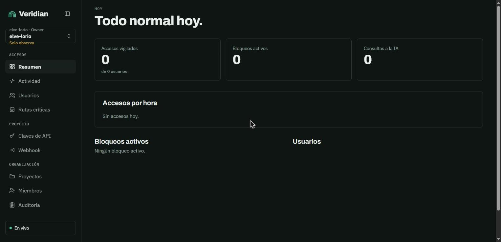
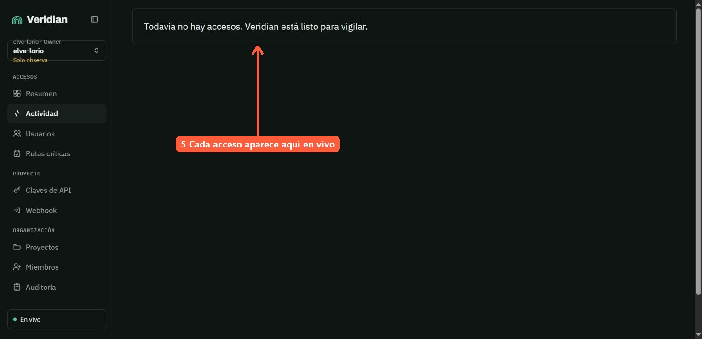
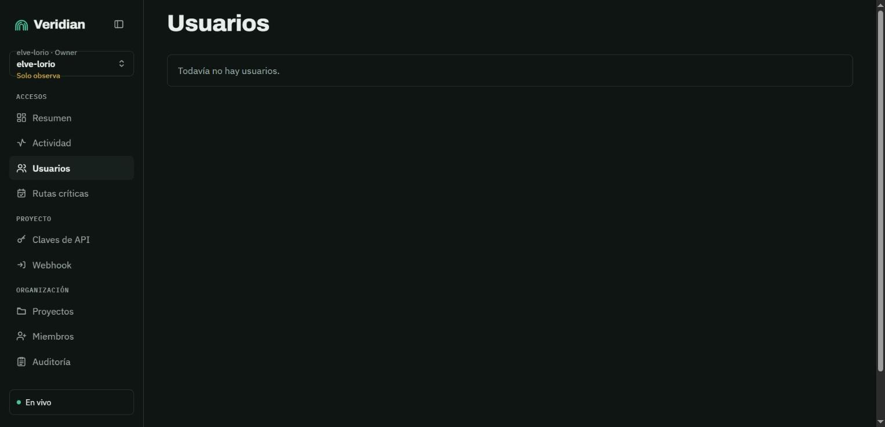
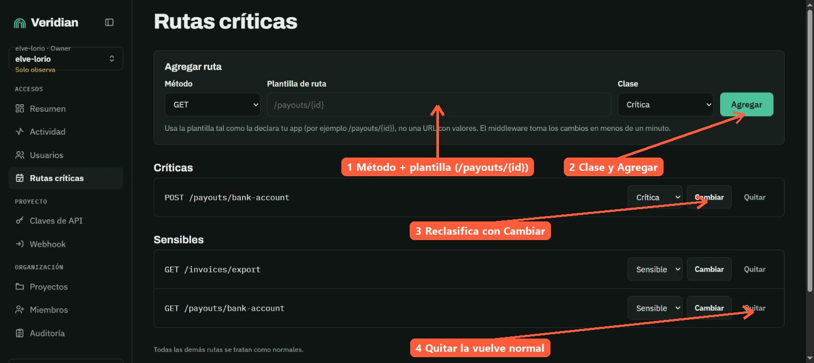
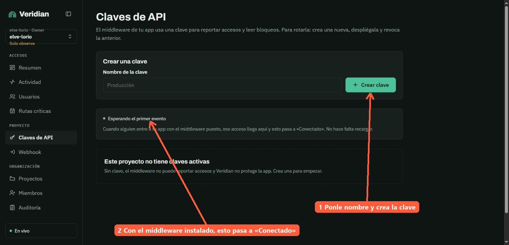
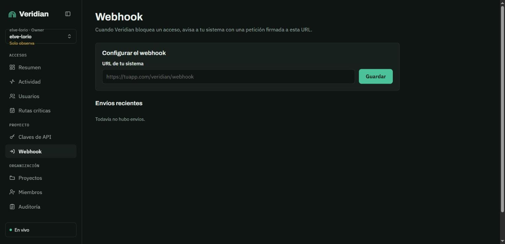
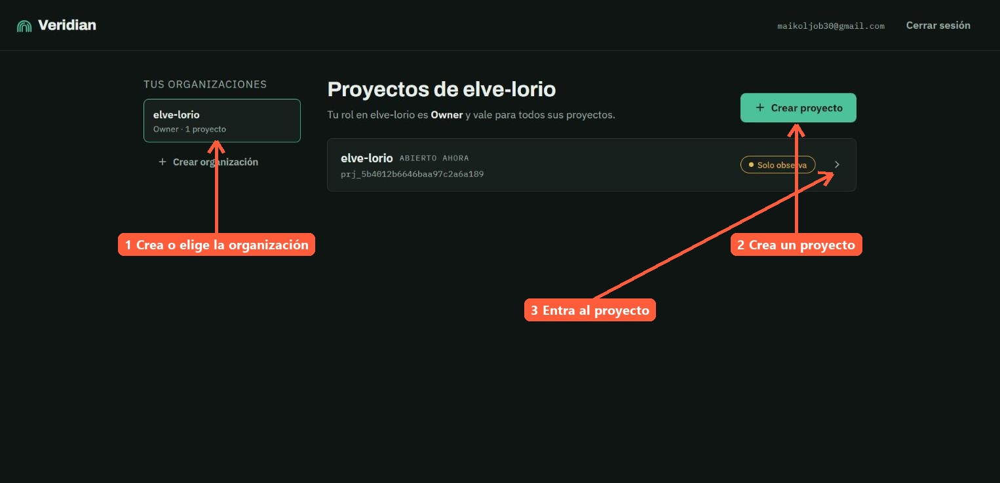
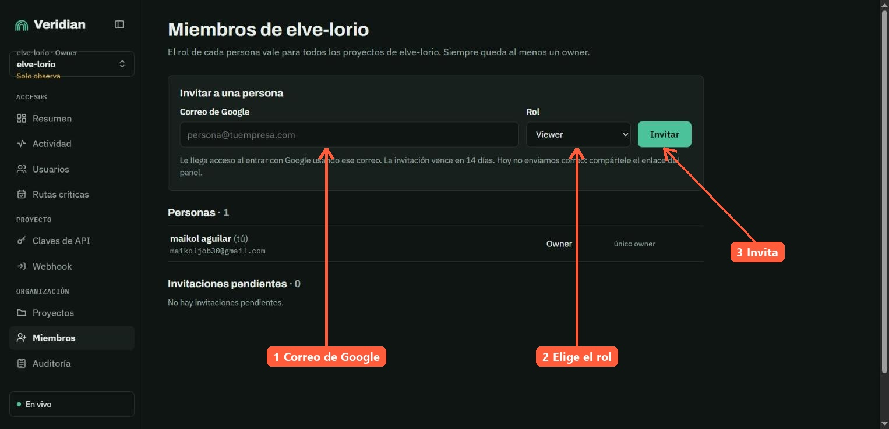
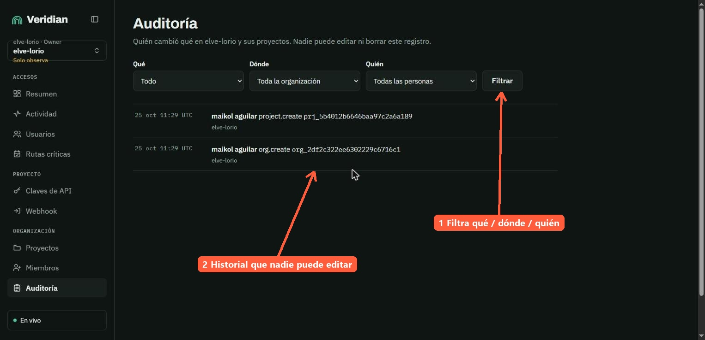

# Guía de uso del panel de Veridian

Mapa de cada menú del panel y para qué sirve. Capturas tomadas del panel desplegado (`veridian-panel.onrender.com`), proyecto de ejemplo recién creado, el 25 oct 2026.

**Cómo leer las capturas:** las flechas naranjas señalan dónde hacer clic. Los números siguen el flujo de puesta en marcha: Proyectos (1–3) → Claves de API (1–2) → Webhook (3–4) → Actividad (5) → Resumen (6).

## Mapa general

```
┌──────────────────────────────┐
│ ◆ Veridian            [▯]    │ ← Logo: vuelve al Resumen · [▯] colapsa el menú
├──────────────────────────────┤
│ Org · Rol                    │
│ Proyecto actual              │ ← Selector: cambia de organización o proyecto
│ Solo observa                 │ ← Modo del proyecto (solo observa / bloquea)
├──────────────────────────────┤
│ ACCESOS                      │
│   Resumen                    │ → Estado del día en cifras
│   Actividad                  │ → Cada acceso y la decisión del motor
│   Usuarios                   │ → Usuarios vistos y su perfil
│   Rutas críticas             │ → Marcar rutas críticas o sensibles
│ PROYECTO                     │
│   Claves de API              │ → Clave del middleware + estado de conexión
│   Webhook                    │ → Aviso firmado a tu sistema al bloquear
│ ORGANIZACIÓN                 │
│   Proyectos                  │ → Organizaciones y proyectos
│   Miembros                   │ → Invitar personas y asignar roles
│   Auditoría                  │ → Quién cambió qué (no editable)
├──────────────────────────────┤
│ ● En vivo                    │ ← Conexión con el motor
│ correo   [Cerrar sesión]     │ ← Tu cuenta
└──────────────────────────────┘
```

> Si no hay proyecto elegido, el grupo PROYECTO y Auditoría no aparecen. Si el motor no responde, el pie dice **Motor sin conexión** y las páginas avisan "Reintentando…".

## ACCESOS: lo que pasa con las credenciales

### Resumen

- Titular del día (p. ej. **"Todo normal hoy."**).
- Tres cifras → **Accesos vigilados** (y de cuántos usuarios), **Bloqueos activos** y **Consultas a la IA**.
- **Accesos por hora** → gráfico del día.
- **Bloqueos activos** y **Usuarios** → listas rápidas para saltar al detalle.

### Actividad

- Lista en vivo de cada acceso que reporta el middleware, con la decisión del motor.
- El menú muestra un contador cuando hay bloqueos recientes.
- Vacía ("Veridian está listo para vigilar") hasta que llega el primer acceso.

### Usuarios

- Los usuarios de tu app que Veridian ha visto y el perfil que aprendió de cada uno.
- Sirve para entender por qué un acceso se salió de lo normal.

### Rutas críticas

- **Críticas** → rutas de máximo riesgo (p. ej. `POST /payouts/bank-account`).
- **Sensibles** → rutas que exponen datos (p. ej. `GET /invoices/export`).
- **Agregar ruta** → método + plantilla tal como la declara tu app (`/payouts/{id}`, no una URL con valores) + clase → Agregar.
- **Cambiar** → reclasifica una ruta (crítica ↔ sensible). **Quitar** → vuelve a ser normal.
- El middleware toma los cambios en menos de un minuto. El resto de rutas se trata como normal.

## PROYECTO: conectar tu aplicación

### Claves de API

- **Crear una clave** → la usa el middleware para reportar accesos y leer bloqueos.
- **Estado** → "Esperando el primer evento" pasa a «Conectado» sin recargar cuando llega el primer acceso.
- **Rotar** → crea una nueva, despliégala y revoca la anterior.

### Webhook

- **URL de tu sistema** → Veridian envía ahí una petición firmada cada vez que bloquea un acceso.
- **Envíos recientes** → historial de avisos para comprobar que llegan.

## ORGANIZACIÓN: equipo y gobierno

### Proyectos

- **Tus organizaciones** → elegir o **crear organización**.
- **Crear proyecto** → uno por app o entorno. Cada tarjeta muestra el id y el modo (p. ej. **Solo observa**).
- Tu rol en la organización vale para todos sus proyectos.

### Miembros

- **Invitar a una persona** → correo de Google + rol (p. ej. Viewer). La invitación vence en 14 días; hoy no se envía correo, hay que compartir el enlace.
- **Personas** e **Invitaciones pendientes**. Siempre queda al menos un owner.

### Auditoría

- Quién cambió qué en la organización y sus proyectos (p. ej. `org.create`, `project.create`).
- Filtros **Qué / Dónde / Quién**. Nadie puede editar ni borrar este registro.

## Flujo recomendado (primera vez)

```
Proyectos → Claves de API → instalar middleware → Webhook → Actividad → Resumen
  crear       crear clave     reporta accesos      avisos    ver en vivo   estado
```
